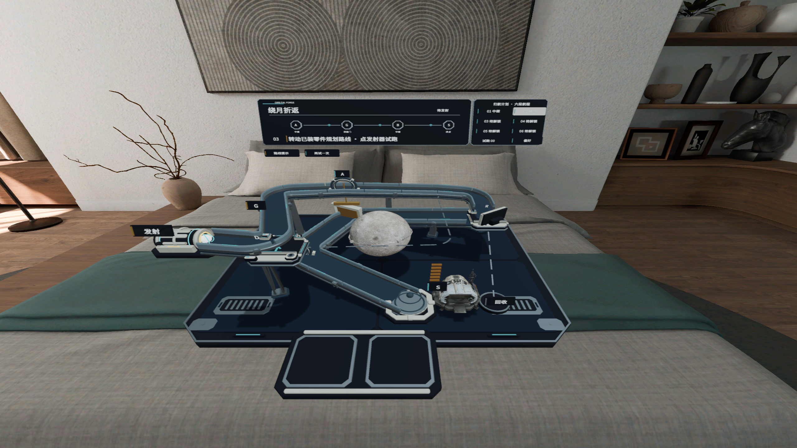
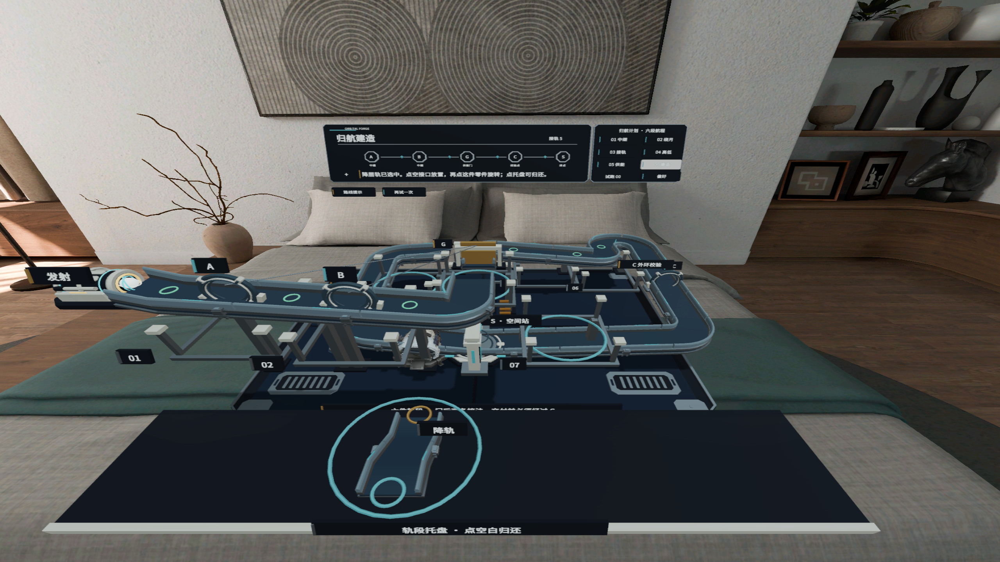
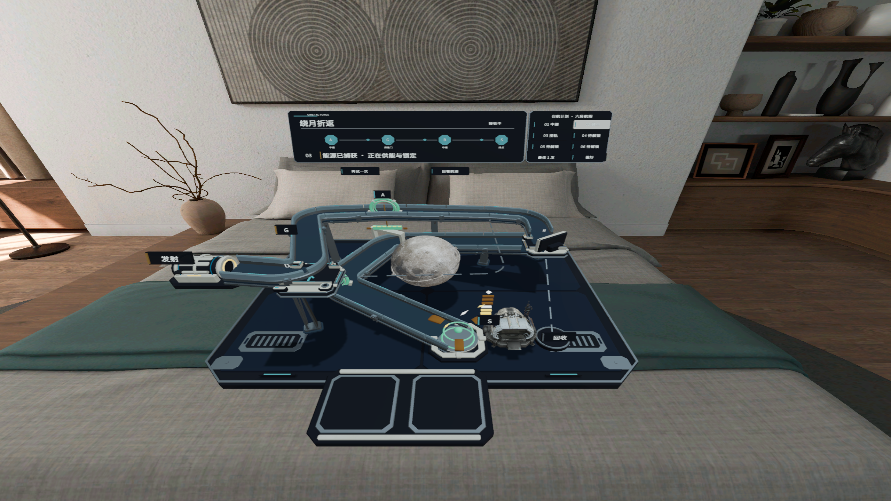

# 星轨重构 · ORBITAL FORGE

**重构星轨，点燃深空。**

《星轨重构》是一款面向 PICO Shared Space 的桌面空间解谜游戏。把一座微型航天装置放进你的空间，点选、安放并旋转三维轨段，为能源球规划经过指定目标、最终抵达空间站的航线。

能源球沿轨道滚动、反弹，实际试射会检验你的设计。轨道接通之后，还要读懂接口高差、行进方向与目标顺序：绕月去程先供电，低层返程再穿过闸门；一条看似直接的交付路线，也可能漏掉关键目标。观察失败提示与真实轨迹，调整零件，再试一次。

## 玩法

- **实体轨段拼装**：点选托盘中的零件，点选接口安放，再调整已装轨段的朝向。
- **路线与因果推理**：安排同一颗能源球经过供能目标、返程门与接收站，判断方向、先后顺序和高差。
- **真实试射与复盘**：球的运动、碰撞和目标触发由物理系统决定；通过回收、重试与轨迹回看修正路线。
- **Shared Space 桌面装置**：深蓝机械底座、陶瓷轨道、月球与空间站组成一座可从不同角度观察的立体谜题。

交互以系统提供的目标点选事件为基础，支持选择、安放和转向；当前实现不依赖读取原始手部姿态。持续拖拽不作为已完成验收的能力。

## 第一章 · 归航计划

| 关卡 | 解题重点 |
| --- | --- |
| 01 · 点亮中继 | 认识目标顺序，调整道岔与返程方向 |
| 02 · 绕月折返 | 去程供电、返程穿门，理解上下层路线的因果关系 |
| 03 · 接轨初航 | 使用直轨与弯轨连接缺口，让入口和出口对齐 |
| 04 · 高低接驳 | 比较接口高度，用降轨完成高低层接驳 |
| 05 · 供能回路 | 先供电再过门，接通通向下一目标的低层路线 |
| 06 · 归航建造 | 综合拼装供电、过门与交付路线，经过检查点后抵达空间站 |

## 游戏画面

以下截图来自 **PICO 模拟器中的 Play-to-PICO 原生空间画面**，展示 Shared Space 中的实际预览效果。Play-to-PICO 由 Unity Editor 运行玩法逻辑，截图不代表真实头显性能测试。

### 绕月折返：规划去程与返程



### 立体拼装：选择轨段，补齐接口



### 能源接驳：抵达空间站，启动供能



## 打开项目

| 项目 | 配置 |
| --- | --- |
| Unity | **6000.3.25f1** |
| 目标平台 | Android / PICO Shared Space |
| 脚本后端 | IL2CPP |
| CPU 架构 | ARM64 |
| 主场景 | `Assets/SpaceBall/Scenes/OrbitalCourier_Prototype.unity` |

1. 安装对应 Unity Editor，并安装 Android Build Support、Android SDK & NDK Tools 和 OpenJDK 模块。
2. 使用 Unity Hub 打开仓库根目录。Unity 会按 `Packages/manifest.json` 与 `Packages/packages-lock.json` 自动还原依赖，等待包解析、导入和脚本编译完成。
3. 确认构建平台为 Android，保留项目现有的 PICO Spatial / Shared Space 配置。
4. 打开上述主场景，在 Editor 中查看场景；设备空间外观可通过项目已配置的 Play-to-PICO 流程预览。

内部仍保留部分 `SpaceBall` / `OrbitalCourier` 类名和资源路径，以维持已有资源引用与存档兼容；游戏正式显示名为“星轨重构”。

## 构建 APK

退出 Play 模式后，使用 Unity 菜单：

```text
SpaceBall > Build Android First Chapter
```

或在 Unity Editor 中调用：

```csharp
SpaceBall.Editor.OrbitalAndroidBuild.Build();
```

输出文件：

```text
Builds/SpaceBall/OrbitalForge-Chapter1.apk
```

**请使用上述项目构建入口。** 它包含 Spatial 资源导出、材质处理、官方 bundle 打包及最终 APK 资源校验；普通 Build 按钮不能替代这套流程。构建报告写入 `Builds/SpaceBall/chapter-build-report.json`。当前入口生成用于验证的 Development APK。

## 验证范围

已有独立 Android 开发包在 PICO 模拟器中完成六关参考路线、普通启动与存档保留检查。参考路线测试由隔离开发入口摆放真实轨段，球的飞行和通关由实际物理与目标传感器决定；这与玩家通过原生界面独立解完六关是不同的验收范围。

本项目仍需补充真人首次上手、持续拖动、真实头显性能、长时间稳定性及正式发布验证。现有截图和自动化结果不等同于已通过商店上线验收。

## 资源来源与许可文件

- **月球素材**：NASA Scientific Visualization Studio 的 LROC / LOLA 月球数据及派生贴图。原始来源、署名、加工方法和相关使用说明位于 [`Assets/SpaceBall/Art/LunarSurvey/provenance.md`](Assets/SpaceBall/Art/LunarSurvey/provenance.md)，源数据和加工脚本位于同目录。NASA 不为本游戏背书。
- **中文字体**：Noto Sans CJK SC；字体文件位于 `Assets/SpaceBall/Fonts/NotoSansCJKsc-Regular.otf`，随附 OFL 许可位于 [`Assets/SpaceBall/Fonts/NotoSansCJK-OFL.txt`](Assets/SpaceBall/Fonts/NotoSansCJK-OFL.txt)。

复制或分发第三方资源时，请一并保留其来源与许可文件。
